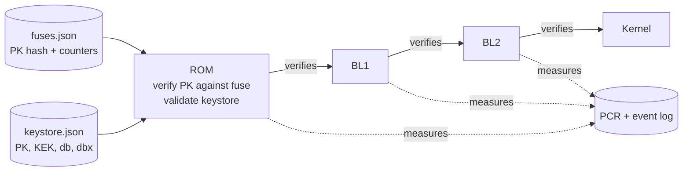
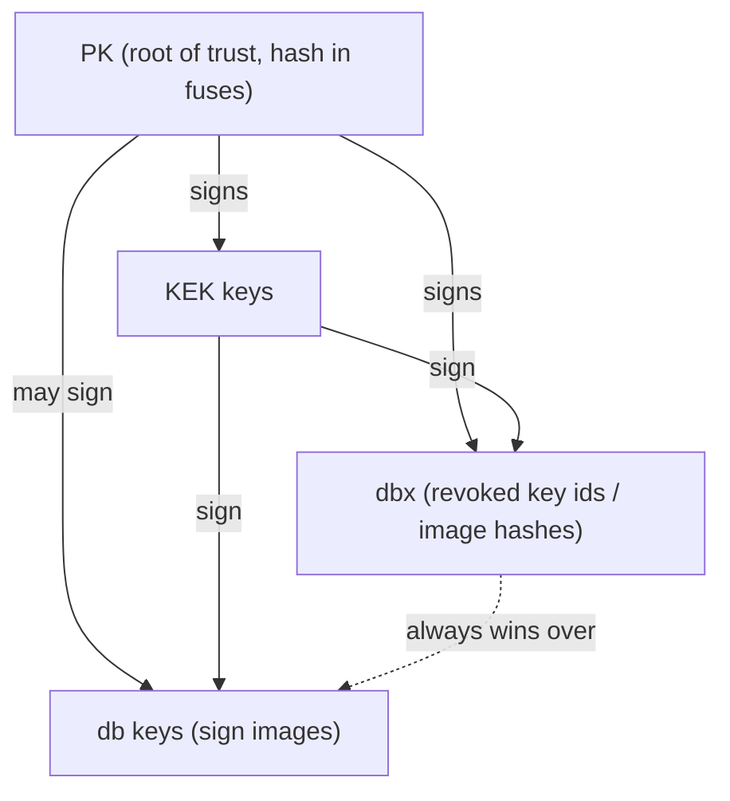

# Architecture

## Boot chain

## Key hierarchy

## Modules and allowed dependencies

Imports point downward only.

| Layer | Modules |
|---|---|
| 0. Primitives | `errors`, `crypto` |
| 1. Formats | `image` |
| 2. Trust and policy | `keystore`, `policy` |
| 3. Execution | `rom`, `chain` |
| 4. Measurement | `measure` |
| 5. Bridge | `efi` |
| 6. Interface | `cli` |

## Data formats

- **Image:** `header (56 bytes) | payload | Ed25519 signature (64 bytes)`. Header `<4sHHII32s8s`: magic `HMDL`,
  format version, stage id (1 BL1, 2 BL2, 3 kernel), security counter, payload length, payload SHA-256, signing key id
  (first 8 bytes of SHA-256 of the raw public key). The signature covers header + payload.
- **fuses.json:** SHA-256 of the PK, and one counter per stage. Written once by `provision`; afterwards only counters can rise.
- **keystore.json:** mode (`setup`/`user`), PK, signed KEK and db entries, signed dbx entries. Every entry carries its
  signer's key id and an Ed25519 signature with a domain-separated message.
- **events.json:** `{stage, sha256}` per stage and the final PCR. `PCR = SHA256(PCR || sha256(image file))`.

## Per-stage checks (in order)

1. read the file once into memory (size-capped) · 2. strict parse · 3. stage id matches the slot ·
4. dbx: key id and whole-file hash · 5. look up the signing key in db · 6. payload hash and signature ·
7. anti-rollback counter · 8. measure into the PCR · 9. execute the verified in-memory bytes.

After the whole chain verifies, counters are raised in the fuses and the event log is written.
Any failure halts the chain, exits non-zero and leaves counters and log untouched.

## Rules

1. Only `rom.provision` creates `fuses.json`; only `rom.commit_counters` changes it afterwards, and only upward.
2. Private keys are read only by `cli` signing commands. `chain` and `rom` never see them.
3. Every hash/key comparison goes through `crypto.constant_time_equal`.
4. Only `efi.py` starts processes, always with `shell=False`.
5. Verification errors are always fatal; no blanket `except` that continues.
6. Every defense has an attack test under `tests/attacks/`.
